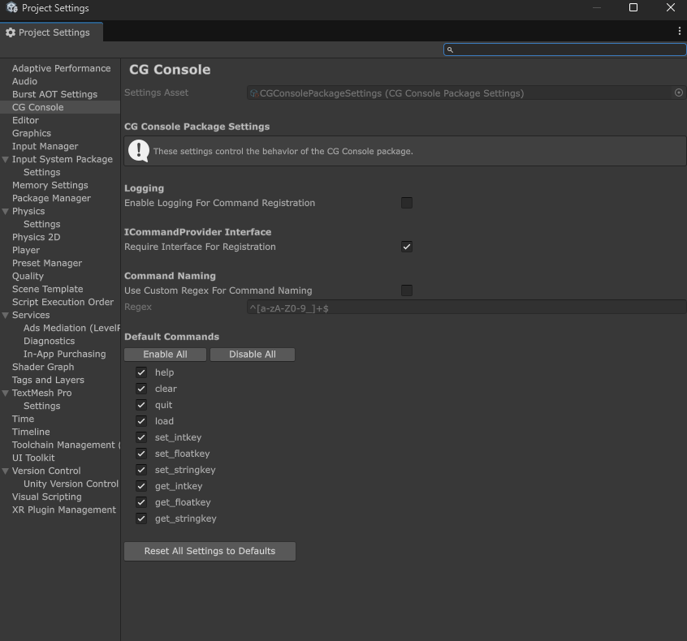

# CG Console

**A developer console that allows you to easily create your own commands.**

Speed up testing by adding an in-game developer console that can execute any custom commands.


## Highlights

- **Easy to use.** All you have to do is add a `[ConsoleCmd]` attribute to any function.
- **Customizable behaviors.** Within the package settings, you can enable/disable default commands, modify the regex validation string, and more.
- **Automatic command registration.** Commands are automatically registered on MonoBehaviours.

---

## Contents

- [Installation](#installation)
- [Quick Start](#quick-start)
- [Getting Started](#getting-started)
    - [Package Settings](#package-settings)
    - [Attribute Usage](#attribute-usage)
    - [Executing Commands](#executing-a-console-command)
- [Known Limitations](#known-limitations)
- [Roadmap](#roadmap)


---

## Installation


1. Open **Window -> Package Manager**.
2. Click **+ -> Install package from git URL**.
3. Paste the URL of the desired version like:
4. Replace the tag with the latest version from the [Releases](https://github.com/Contradictive-Games/CGConsole/releases) page.

```text
https://github.com/Contradictive-Games/CGConsole.git#v0.8.0
```

**Requirements:**
- Unity 6000.0+
- Unity uGUI 2.0.0+

To try any samples, select the package in **Package Manager** and open the **Samples** tab.

## Quick Start

1. Import the **Console Demo** sample and drag `ConsolePanel` into your scene
   (or add the **CG Console/Console Window** component to your own UI).
2. Add a command to any MonoBehaviour that implements `ICommandProvider`:

    ```csharp
       public class Player : MonoBehaviour, ICommandProvider
       {
           [ConsoleCmd("heal", "Restore health")]
           private void Heal(int amount) => health += amount;
       }
    ```
3. Enter Play Mode and type `heal 50`. Type `help` to list every command.

## Getting Started

### Package Settings

CG Console offers a few package customization options so that you can get this package to fit your needs maybe a bit better, or to also support custom command development.

To access the settings, in the toolbar you will need to select `Edit/Project Settings/CG Console`. If there is no settings asset that already exists, it will prompt you to create a new settings asset, or you can optionally right click in the Project window and select `CG Console/Package Settings`.

The window will look like:




Default package settings and what they do:


- EnableLoggingForCommandRegistration ***(default: false)***
    - This setting will log into the console the details for when the command was being registered
- RequireInterfaceForRegistration ***(default: true)***
    - Enabling this means that any time you want any of your classes to be able to successfully register a command, you must implement the `ICommandProvider` interface
- UseCustomRegexForCommandNaming ***(default: false)***
    - This allows you to define your own custom regex string for command names. When you use the `ConsoleCmd` attribute - the command's name by default must be alphanumeric, and can contain underscores. You can however switch this to true, and define your own regex string for how commands can be named.
    - ***Warning***: This can potentially break some default console behaviors or cause undesired interactions. For instance, if you allow the `?` to be at the end of a command name, the default functionality for when you type a command with the `?` at the end it will give the command's defined description as well as the arguments required to perform the command.
- Regex ***(default: ^[a-zA-Z0-9_]+$)***
    - This is the regex string that we will use to validate a `ConsoleCmd`'s name value. This can not be edited unless you toggle `UseCustomRegexForCommandNaming` to `true`.
- Default Commands ***(default: all enabled)***
    - These are some of the default commands, which you can selectively enable/disable - if you'd like to be able to define your own custom versions. As an example, the DefaultCommand `load` does not asynchronously load scenes and may override your own `load` scene command's behaviors if you keep this enabled.

#### Default Commands

Command | Usage | Description |
|---|---|
| `help` | `help` | Lists all registered commands |
| `clear` | `clear` | Clears the console output |
| `quit` | `quit` | Exits the application or play mode in the editor |
| `load` | `load <scene_name>` | Loads a scene (scene must be in Build Settings, non-async) |
| `set_intkey` | `set_intkey <key> <value>` | Sets an int PlayerPref |
| `set_floatkey` | `set_floatkey <key> <value>` | Sets an float PlayerPref |
| `set_stringkey` | `set_stringkey <key> <value>` | Sets an string PlayerPref |

### Default Behaviors

The default Console has a few built-in behaviors that do not require any additional setup. 

The main one is the `?` mod. When typing any command and adding the `?` to the end of the command, it will list command's description (if provided) as well as the required argument types to successfully execute the command.

The console also offers suggestions for commands you may want to type by searching through the commands list based off your input. This does a simple lookup by character matching.


### Attribute Usage

To be able to add commands to the registry, simply add the `ConsoleCmd` attribute above the function you would like to make into a command. Functions are **not** required to be `public`. The `ConsoleCmd` attribute will require the command name, but will additionally accept a string for an optional description, as well as a boolean to mark whether you would like it to be visible in the suggestion list, and a boolean to mark whether this command will be listed within the `help` command.

```csharp
[ConsoleCmd(
    commandName: "example_command", 
    description: "This command will not show up in `help` or auto-completion/show up in suggestions",
    hideFromAutoComplete:true, //defaults false
    hideFromHelpCommand:true //defaults false
)]
public void CommandIDontWantVisible(){
    /*
        Do something
        When typing the `help` command, this command will not be listed
        When typing in the console's input field, this command will not be listed with the other commands for auto-completion/in the suggestions list
        It will otherwise still execute as normal 
    */
}

[ConsoleCmd("log_normal")]
public void MyExampleCommand(){
    Debug.Log("We successfully executed the `log_normal` command");
}

[ConsoleCmd("log_number")]
public void MyExampleCommandWithArgs(int arg){
    Debug.Log($"Your number was: {arg}");
    /*
        If we were to try to execute this command either as: `log_number` without any additional args, or with an incorrect arg
        it will not succeed. So long as we provide the int when executing the command, it will work
        `log_number 5` would succeed
    */
}

[ConsoleCmd("game_state", "Log the game's current state")]
public void MyExampleCommandThatHasADescription(){
    //Log the game's state
}
```

### Registering Commands

Commands do **not** need to be registered from MonoBehaviours as it is done automatically, however if you want to add a `ConsoleCmd` to a plain C# class, make sure it is registered by doing:

```csharp
private IDisposable registration;
void Init()    => registration = ConsoleCommands.Register(myPlainObject);
void Cleanup() => registration.Dispose();
```


### Executing a Console Command

Commands can both be executed within a script and by typing the command within the `ConsoleWindow` input field (or your own custom input field that parses the value and can submit the value like the script does, as this is what the `ConsoleWindow` class does by default). 

To execute a command within a script you can do:

```csharp
ConsoleCommands.TryExecute("command_goes_here");
```

The `TryExecute` method returns a `CommandResponse` which has the properties `ResponseType` and `Message`.

`ResponseType` has 4 types:
- `ResponseType.Success`
- `ResponseType.Invalid`
- `ResponseType.Info`
- `ResponseType.Error`


## Known Limitations

- Console Commands currently do not support more complex data types like `struct`, `Vector3`, `Vector2`, etc (in roadmap)
- Console output is currently creating/destroying output log objects, instead of pooling (in roadmap)


## Roadmap

Features that are not currently in this package, but I would eventually like to add

- [ ] Support structs as console command arguments
- [X] Support gathering commands automatically, rather than manual registration
- [ ] Add auto-complete when typing a command in Console input field
    - [X] Add suggestion box when typing a command for possible command inputs
    - [ ] Pressing `Tab` auto fills in first suggestion
    - [ ] Users can cycle through options in suggestion box with Up/Down arrow keys
- [x] Support non-MonoBehaviour classes being able to utilize commands
- [ ] Console window resizing/dragging
- [ ] Dev build only console commands
- [ ] Pool console output logs